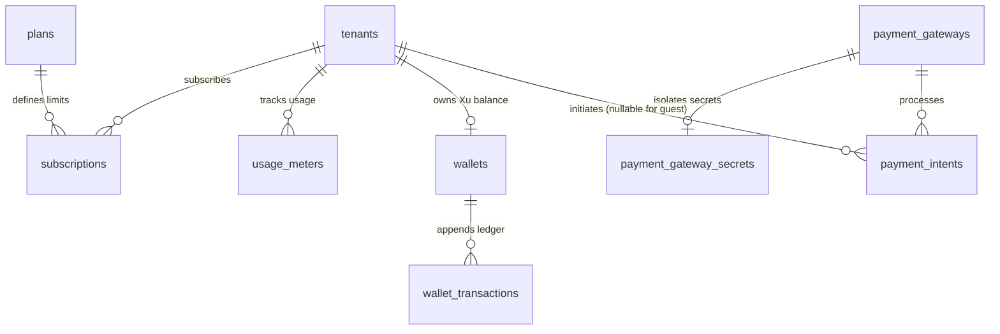

# 💎 Enterprise Plugin: Subscriptions, Quota & Multi-Platform Payment Gateway (`subscriptions`)

> **Multi-Tenant SaaS Billing, Prepaid `Xu` Wallet & Pluggable Payment Gateway Engine**  
> Provides tiered SaaS subscription plans (`billing.plans`), tenant subscription tracking (`billing.subscriptions`), resource metering (`billing.usage_meters`), integer **`Xu` (`credits` — `BIGINT`)** prepaid wallets (`billing.wallets`, `billing.wallet_transactions`), and an extensible multi-channel payment gateway (`billing.payment_gateways`, `billing.payment_intents`).  
> 📖 **Terminology Standard**: Review the [**Terminology Dictionary & Anti-Hallucination Lexicon (docs/terminology_dictionary.md)**](../../../docs/terminology_dictionary.md) for strict naming invariants.

---

## 1. Architectural Specifications

| Property | Technical Specification |
|---|---|
| **Plugin ID** | `subscriptions` |
| **Classification** | **On-Demand Business Plugin** |
| **PostgreSQL Schema** | `billing` (Fully isolated from `public`) |
| **Version** | `1.2.0` |
| **Dependencies** | `core-iam` |
| **Installation Script** | [`install.sql`](install.sql) |
| **Uninstallation Script** | [`uninstall.sql`](uninstall.sql) |

---

## 2. Table Directory: Schema `billing` (8 Tables)

### 1. `billing.plans` & `billing.subscriptions` & `billing.usage_meters`
Defines SaaS service tiers (`free`, `pro`, `enterprise`), active tenant subscription states, and real-time quota meters (`storage_mb`, `monthly_runs`).

### 2. `billing.wallets` & `billing.wallet_transactions` (Prepaid `Xu` Ledger)
* `balance_credits` (`BIGINT NOT NULL DEFAULT 0 CHECK (balance_credits >= 0)`): Canonical virtual currency balance in integer **Xu**.
* `wallet_transactions`: Immutable append-only audit trail (`tx_type`: `topup`, `purchase`, `refund`, `admin_adjustment`, `bonus`) with BRIN indexing on `created_at`.

### 3. `billing.payment_gateways` & `billing.payment_gateway_secrets`
* Supports 5 extensible payment channels (`billing.payment_channel`):
  1. `internal_wallet`: Instant 1-click `Xu` deduction (`rate_per_credit = 1`).
  2. `bank_transfer`: Domestic 24/7 Bank Transfer (manual copy + dynamic VietQR/Napas247 image) reconciled via SePay / PayOS / Casso / Web2M webhooks.
  3. `e_wallet`: Domestic e-wallets (**MoMo**, **ZaloPay**) via personal transfer memo or Merchant IPN.
  4. `card_intl`: International Visa/Mastercard/Apple Pay via **Stripe** Checkout.
  5. `crypto`: **USDT** (TRC20/BEP20) and **Binance Pay**.
* Secrets (`webhook_secret`, API keys) are physically isolated in `billing.payment_gateway_secrets` (accessible strictly to `service_role` and `public.is_platform_admin()`).

### 4. `billing.payment_intents`
* Tracks payment lifecycle across `pending`, `processing`, `manual_review`, `succeeded`, `failed`, `expired`, and `refunded`.
* Generates a unique 8-character memo code (`TQxxxxxx`) for deterministic bank/MoMo reconciliation.
* Automatically holds expired (`> 30 minutes`) or underpaid transfers in `status = 'manual_review'` for Platform Admin approval (`_force_approve = TRUE`).

---

## 3. Core Billing, Wallet & Payment RPC Functions

* `billing.check_tenant_quota(_tenant_id, _metric_name, _increment)`
* `billing.record_usage(_tenant_id, _metric_name, _increment)`
* `billing.credit_tenant_wallet(_tenant_id, _amount_credits, _tx_type, _reference_type, _reference_id, _description)`
* `billing.debit_tenant_wallet(_tenant_id, _amount_credits, _tx_type, _reference_type, _reference_id, _description)`
* `billing.get_active_gateways()`
* `billing.create_payment_intent(_gateway_id, _target_type, _target_id, _amount_credits, _tenant_id, _buyer_email)`
* `billing.settle_payment_intent(_intent_id, _transfer_code, _provider_tx_id, _actual_pay_amount, _raw_metadata, _force_approve)`

---

## 4. Permissions Dictionary

| Permission ID | Module | Business Capability | Owner | Admin | Member |
|---|---|---|:---:|:---:|:---:|
| `subscriptions:read` | `billing` | View active plan, limits, and billing history | ✅ | ✅ | ✅ |
| `subscriptions:manage` | `billing` | Upgrade, downgrade, or cancel subscriptions | ✅ | ✅ | ❌ |
| `quota:read` | `billing` | Inspect real-time consumption meters | ✅ | ✅ | ✅ |
| `wallets:read` | `billing` | View tenant `Xu` wallet balance and transaction ledger | ✅ | ✅ | ✅ |
| `wallets:manage` | `billing` | Top up or spend from tenant `Xu` wallet | ✅ | ✅ | ❌ |
| `payments:read` | `billing` | View payment gateways and payment intents | ✅ | ✅ | ✅ |
| `payments:manage` | `billing` | Configure gateways and approve `manual_review` intents | ✅ | ✅ | ❌ |
