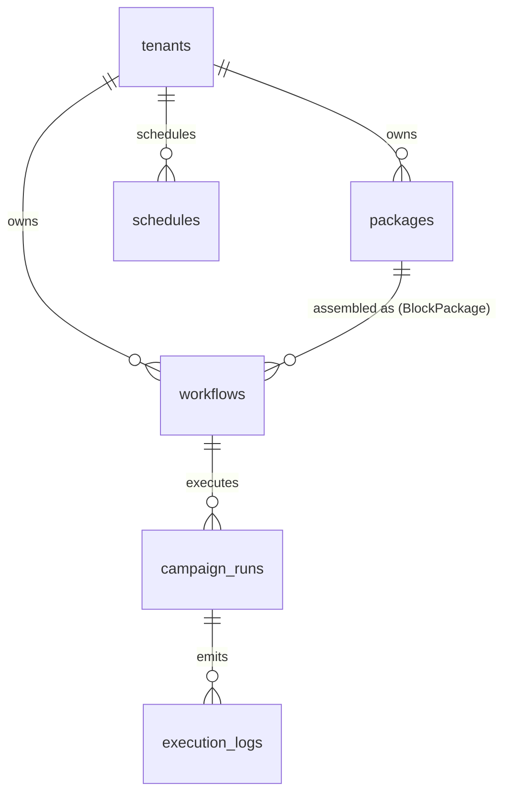

# 🤖 Enterprise Plugin: Workflows Cloud Bridge (`workflows`)

> **Distributed Automation Fleet Orchestration & Workflow Infrastructure**  
> Provides enterprise-grade infrastructure for storing visual workflow ASTs, official Automa reusable composite block packages (`workflows.packages`), registering and monitoring distributed worker runners (Desktop Workers / Cloud VPS), dispatching and tracking batch execution campaigns with atomic queue claiming (`FOR UPDATE SKIP LOCKED`), streaming granular telemetry logs, and managing automated cron schedules for the Tuquet automation ecosystem.  
> 📖 **Terminology Standard**: Review the [**Terminology Dictionary & Anti-Hallucination Lexicon (docs/terminology_dictionary.md)**](../../../docs/terminology_dictionary.md) for strict domain invariants.

---

## 1. Architectural Specifications

| Property | Technical Specification |
|---|---|
| **Plugin ID** | `workflows` |
| **Classification** | **On-Demand Domain Plugin** |
| **PostgreSQL Schema** | `workflows` (Completely isolated from `public`) |
| **Version** | `1.0.0` |
| **Dependencies** | `runners` (Execution nodes registered in `runners.devices`) |
| **Installation Script** | [`install.sql`](install.sql) |
| **Seed Data** | [`seed.sql`](seed.sql) |
| **Uninstallation Script** | [`uninstall.sql`](uninstall.sql) |

---

## 2. Schema Entity Directory (`workflows`)

### 1. `workflows.workflows`
Stores visual automation node graphs adhering to DAG AST specifications.
* **Key Columns:** `id`, `tenant_id`, `name`, `description`, `version`, `status` (`draft`, `published`, `archived`), `graph_data` (JSONB storing `nodes` and `edges`), `variables`, `settings`, `deleted_at`.
* **RLS Policies:** Tenant members with `workflows:workflows:read` can view graphs; `workflows:workflows:manage` is required to create, update, publish, or soft-delete workflows.

### 2. `workflows.packages` (Official Automa Block Packages)
Stores modular composite block packages adhering 1:1 to official Automa AST specifications (`BlockPackage.vue` / `handlerBlockPackage.js`).
* **Key Columns:** `id`, `tenant_id`, `name`, `description`, `icon` (`mdiPackageVariantClosed`), `version`, `is_external`, `settings` (`{"asBlock": true}`), `inputs` (`[{ id, name, blockId, handleId }]`), `outputs` (`[{ id, name, blockId, handleId }]`), `variables`, `data` (`{ "nodes": [], "edges": [] }`), `created_by`, `deleted_at`.
* **RLS Policies:** `workflows:packages:read` to inspect available block packages; `workflows:packages:manage` to create, edit, or publish packages.

### 3. `workflows.campaign_runs`
Tracks batch execution sessions dispatching workflows across distributed runner nodes (`runners.devices`).
* **Key Columns:** `id`, `tenant_id`, `workflow_id`, `runner_id`, `name`, `status` (`pending`, `queued`, `running`, `paused`, `completed`, `failed`, `cancelled`), `total_tasks`, `completed_tasks`, `failed_tasks`, `started_at`, `ended_at`.
* **Queue Claiming:** Edge runners claim batches atomically with zero contention using `workflows.claim_next_campaign_run(runner_id, batch_size)` (`FOR UPDATE SKIP LOCKED`).
* **Dead Lease Reaper:** Crashed runners are automatically detected via heartbeat timeout and reaped with `workflows.reap_stale_campaign_runs()`.
* **RLS Policies:** `workflows:campaigns:read` to inspect execution progress; `workflows:campaigns:run` to dispatch campaigns; `workflows:campaigns:manage` to pause, cancel, or delete sessions.

### 4. `workflows.execution_logs`
High-throughput telemetry and block-level execution logs for real-time debugging and auditing.
* **Key Columns:** `id` (`BIGINT GENERATED ALWAYS AS IDENTITY`), `tenant_id`, `campaign_run_id`, `node_id`, `step_name`, `level` (`trace`, `debug`, `info`, `warn`, `error`, `fatal`), `message`, `payload`, `logged_at`.
* **Indexes:** Composite B-Tree `idx_workflows_logs_campaign (tenant_id, campaign_run_id, logged_at DESC)` and high-throughput BRIN index `idx_workflows_logs_logged_at_brin (logged_at)`.
* **RLS Policies:** `workflows:logs:read` to stream and inspect execution logs.

### 5. `workflows.schedules`
Automated cron schedules that trigger workflow campaigns at designated intervals.
* **Key Columns:** `id`, `tenant_id`, `workflow_id`, `name`, `cron_expression`, `timezone`, `is_active`, `last_run_at`, `next_run_at`.
* **RLS Policies:** Scoped strictly by tenant membership and `workflows:campaigns:manage`.
